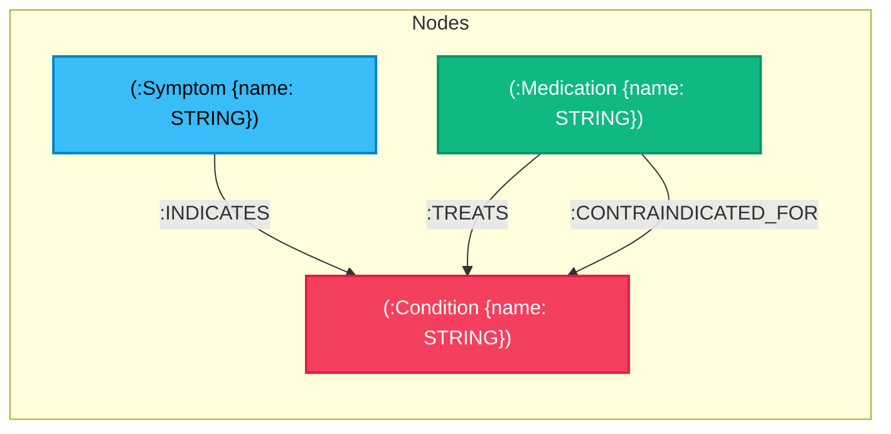

# 🏥 MediGraph — Agentic Clinical Triage & Graph-RAG Platform

> **Hackathon Submission** — Autonomous Clinical Decision Support powered by **FalkorDB Knowledge Graph**, **LangGraph ReAct**, and the **Model Context Protocol (MCP)**.

[](https://github.com/ujwalun11/Medigraph-hackathon)
[](https://www.falkordb.com/)
[](https://modelcontextprotocol.io/)
[](https://langchain-ai.github.io/langgraph/)
[](LICENSE)

---

## 📑 Table of Contents
1. [Overview](#-overview)
2. [🎥 Demo Video](#-demo-video)
3. [Architecture Overview](#-architecture-overview)
4. [Graph Data Model & Ontology](#-graph-data-model--ontology)
5. [Core Cypher Queries & Graph Algorithms](#-core-cypher-queries--graph-algorithms)
6. [Model Context Protocol (MCP) Server](#-model-context-protocol-mcp-server)
7. [5-Layer HIPAA Privacy Architecture](#-5-layer-hipaa-privacy-architecture)
8. [Complete Local Setup & Deployment Instructions](#-complete-local-setup--deployment-instructions)
9. [Evaluation & Clinical Safety Benchmarks (RAGAS)](#-evaluation--clinical-safety-benchmarks-ragas)
10. [API Reference & Sample Clinical Scenarios](#-api-reference--sample-clinical-scenarios)

---

## 🌟 Overview

**MediGraph** is an autonomous clinical decision-support system designed to eliminate medical hallucinations in clinical triage and polypharmacy safety checks. 

Standard LLMs frequently fail when assessing complex multi-condition patients because they evaluate acute symptoms in isolation, missing lethal drug-disease interactions (e.g., prescribing Ibuprofen for joint pain to a patient with Atrial Fibrillation taking Warfarin). 

MediGraph solves this through **Graph-RAG over FalkorDB**:
- An autonomous **LangGraph ReAct agent** that formulates diagnostic hypotheses, traverses clinical knowledge graphs, and asks targeted discriminating questions when symptoms are ambiguous.
- **In-memory FalkorDB (GraphBLAS linear algebra)** delivering sub-15ms graph traversals for shortest-path causal chains, symptom hub centrality, and comorbidity community discovery.
- An **MCP (Model Context Protocol) Server** exposing 9 clinical tools over Server-Sent Events (SSE) for seamless integration with external LLM clients (Claude Desktop, Cursor, Continue).
- A **5-Layer HIPAA Privacy Pipeline** that strips raw PII prior to model ingestion and maps entities locally using an isolated salted Identity Vault.

---

## 🎥 Demo Video

> **Walkthrough Video:** A comprehensive demonstration of MediGraph showcasing autonomous clinical triage, FalkorDB multi-hop graph traversals, interactive clarifying loops, and MCP tool invocations.

* **Watch the Walkthrough Demo:** [Click here to view demo video](./docs/demo.mp4) *(or view on YouTube/Loom: `[Insert Video URL Here]`)*
* **Interactive UI Dashboard:** Built-in interactive dashboard served at `http://localhost:8008/` featuring:
  - Clinical Triage Simulator with real-time graph traversal accordion
  - Natural Language Text-to-Cypher FalkorDB Graph Explorer
  - 5-Layer Privacy & Identity Vault Sandbox
  - MCP Tool Registry Inspector
  - Live RAGAS & LangSmith Benchmark Runner

---

## 🏗️ Architecture Overview

```
                      ┌──────────────────────────────────────────────┐
                      │    Patient / Clinician Interface (Web UI)    │
                      └──────────────────────┬───────────────────────┘
                                             │ POST /api/triage/agentic
                                             ▼
┌────────────────────────────────────────────────────────────────────────────────────────┐
│                        5-LAYER HIPAA PRIVACY GATEKEEPER                                 │
│  Layer 1: Pre-LLM PII Masking  ──►  Layer 2: Salted SHA-256 Pseudo-ID Tokenization     │
│  Layer 3: Output Leak Scanner  ──►  Layer 4: Identity Vault  ──► Layer 5: Audit Log    │
└────────────────────────────────────────────┬───────────────────────────────────────────┘
                                             │ Sanitized Symptoms & History
                                             ▼
┌────────────────────────────────────────────────────────────────────────────────────────┐
│                         LANGGRAPH AUTONOMOUS ReAct AGENT                               │
│                                                                                        │
│   ┌──────────────┐     Decide Tool     ┌──────────────┐   Clarification   ┌────────┐  │
│   │  Agent Node  │ ──────────────────► │  Tool Node   │ ────────────────► │ Paused │  │
│   │ (Gemini 2.5) │ ◄────────────────── │  (FalkorDB)  │                   │ User Q │  │
│   └──────┬───────┘    Observation      └──────────────┘                   └────┬───┘  │
│          │                                                                     │      │
│          │ Complete                                      User Clarification Answer    │
│          ▼                                                                     │      │
│   ┌──────────────┐                                                             │      │
│   │ Final Report │ ◄───────────────────────────────────────────────────────────┘      │
│   └──────────────┘                                                                    │
└────────────────────────────────────────────┬───────────────────────────────────────────┘
                                             │ Tool Calling Handshake via MCP
                                             ▼
┌────────────────────────────────────────────────────────────────────────────────────────┐
│                      MCP SERVER (Port 8010 over SSE Transport)                         │
│  • search_conditions              • find_discriminating_symptoms                      │
│  • find_contraindications         • find_treatments                                   │
│  • verify_medication_safety       • ask_patient_clarification                         │
│  • shortest_path_traversal        • symptom_centrality_ranking                         │
│  • comorbidity_community_detection                                                    │
└────────────────────────────────────────────┬───────────────────────────────────────────┘
                                             │ OpenCypher (GraphBLAS Linear Algebra)
                                             ▼
┌────────────────────────────────────────────────────────────────────────────────────────┐
│                        FALKORDB IN-MEMORY KNOWLEDGE GRAPH                              │
│                                                                                        │
│     (:Symptom) ────────[:INDICATES]────────► (:Condition)                              │
│                                                    ▲                                   │
│                                                    │ [:TREATS]                         │
│                                                    │ [:CONTRAINDICATED_FOR]            │
│                                                    │                                   │
│                                              (:Medication)                             │
└────────────────────────────────────────────────────────────────────────────────────────┘
```

---

## 📊 Graph Data Model & Ontology

The clinical knowledge graph is modeled in **FalkorDB** as a typed property graph:



### Graph Schema Details
| Node Label | Properties | Description |
|:---|:---|:---|
| **`Symptom`** | `name: STRING` | Clinical signs, manifestations, and complaints (e.g., *Chest Pain*, *Shortness of Breath*, *Wheezing*, *Cold Sweat*). |
| **`Condition`** | `name: STRING` | Pathologies and medical diagnoses spanning Cardiology, Pulmonology, Nephrology, Endocrine, etc. |
| **`Medication`** | `name: STRING` | Pharmaceutical drugs, classes, and therapies (e.g., *Ibuprofen*, *Metoprolol*, *Apixaban*, *Aspirin*, *Albuterol*). |

### Relationship Types
| Relationship | Source $\rightarrow$ Target | Semantics & Clinical Significance |
|:---|:---|:---|
| **`:INDICATES`** | `(Symptom) -> (Condition)` | Connects a clinical manifestation to associated candidate conditions. |
| **`:TREATS`** | `(Medication) -> (Condition)` | Guideline-directed medical therapy recommended for the disease. |
| **`:CONTRAINDICATED_FOR`** | `(Medication) -> (Condition)` | Strict safety prohibition; taking this drug causes adverse outcomes or toxicity. |

---

## ⚡ Core Cypher Queries & Graph Algorithms

MediGraph avoids unconstrained LLM text generation by relying on deterministic **FalkorDB OpenCypher** queries and GraphBLAS graph algorithms:

### 1. Multi-Hop Shortest Path Traversal (`find_shortest_clinical_path`)
* **Clinical Purpose:** *"Show the path behind the answer."* Traces indirect multi-hop causal chains connecting a proposed drug to an adverse complication through the patient's existing comorbidities.
* **FalkorDB Cypher:**
```cypher
MATCH (a), (b)
WHERE toLower(a.name) CONTAINS toLower($source_entity) 
  AND toLower(b.name) CONTAINS toLower($target_entity) 
  AND a <> b
MATCH p = (a)-[*1..4]-(b)
RETURN [n IN nodes(p) | n.name] AS path_nodes, 
       [r IN relationships(p) | type(r)] AS rels, 
       length(p) AS hop_count
ORDER BY hop_count ASC
LIMIT 1;
```
* **Example Traversal Result:**
  $$(Ibuprofen) \xrightarrow{CONTRAINDICATED\_FOR} (Atrial\ Fibrillation) \xleftarrow{INDICATES} (Chest\ Pain)$$

---

### 2. Degree Centrality & Hub Ranking (`get_central_clinical_hubs`)
* **Clinical Purpose:** Patients frequently report 5–8 non-specific symptoms (*"fatigued, slightly dizzy, chest discomfort"*). Centrality ranking evaluates graph topology to prioritize high-degree acute hubs over low-urgency complaints.
* **FalkorDB Cypher:**
```cypher
MATCH (s:Symptom)-[:INDICATES]->(c:Condition)
WHERE toLower(s.name) IN [$symptom_list]
RETURN s.name AS symptom, 
       count(c) AS degree_centrality, 
       collect(c.name)[0..3] AS linked_conditions
ORDER BY degree_centrality DESC;
```

---

### 3. Comorbidity Community Detection (`get_connected_clinical_community`)
* **Clinical Purpose:** Discovers connected disease clusters sharing overlapping clinical manifestations to prevent overlooking multi-system syndromes (e.g. *CAD $\leftrightarrow$ Myocardial Infarction $\leftrightarrow$ Hypertension*).
* **FalkorDB Cypher:**
```cypher
MATCH (c:Condition)<-[:INDICATES]-(s:Symptom)-[:INDICATES]->(related:Condition)
WHERE toLower(c.name) CONTAINS toLower($condition) AND related <> c
RETURN related.name AS comorbidity_cluster, 
       count(s) AS shared_symptoms_count, 
       collect(s.name)[0..4] AS shared_symptoms
ORDER BY shared_symptoms_count DESC
LIMIT 4;
```

---

### 4. Differential Disambiguation (`get_discriminating_symptoms`)
* **Clinical Purpose:** When two candidate conditions share high overlap (e.g., *Asthma* vs. *Coronary Artery Disease*), this query computes graph set-difference between their symptom sets so the agent can formulate a discriminating clarifying question.
* **FalkorDB Cypher:**
```cypher
MATCH (s:Symptom)-[:INDICATES]->(c:Condition)
WHERE c.name IN [$condition_a, $condition_b]
RETURN c.name AS condition, collect(s.name) AS symptoms;
-- Applied in Python: syms_unique_a = set(syms_a) - set(syms_b)
```

---

### 5. Deterministic Medication Safety Verification (`check_patient_medication_safety`)
* **Clinical Purpose:** Cross-references proposed drugs against all active pre-existing conditions from the patient's EHR profile.
* **FalkorDB Cypher:**
```cypher
MATCH (m:Medication)-[:CONTRAINDICATED_FOR]->(c:Condition)
WHERE toLower(m.name) CONTAINS toLower($medication)
  AND toLower(c.name) CONTAINS toLower($patient_condition)
RETURN m.name AS medication, c.name AS condition;
```

---

### 6. Guideline Treatment Retrieval (`get_treatments`)
* **Clinical Purpose:** Retrieves approved, guideline-directed first-line medications for a confirmed condition.
* **FalkorDB Cypher:**
```cypher
MATCH (m:Medication)-[:TREATS]->(c:Condition)
WHERE toLower(c.name) CONTAINS toLower($condition)
RETURN m.name AS medication;
```

---

## 🔌 Model Context Protocol (MCP) Server

MediGraph exposes its complete clinical reasoning engine over standard **Model Context Protocol (MCP)** on port `8010` via Server-Sent Events (SSE).

### Registered MCP Tools
| MCP Tool Name | Description | Key Parameters |
|:---|:---|:---|
| `search_conditions` | Hybrid graph search for conditions indicated by symptoms | `symptoms: string[]` |
| `find_discriminating_symptoms` | Set-difference symptom analysis between 2 conditions | `condition_a: str, condition_b: str` |
| `find_contraindications` | Retrieves all contraindicated drugs for a condition | `condition: str` |
| `find_treatments` | Retrieves guideline treatments for a condition | `condition: str` |
| `verify_medication_safety` | Patient-specific contraindication cross-referencing | `medication: str, patient_conditions: str[]` |
| `ask_patient_clarification` | Interactive sentinel tool pausing loop for user clarification | `question: str` |
| `shortest_path_traversal` | Multi-hop causal graph algorithm between two entities | `source_entity: str, target_entity: str` |
| `symptom_centrality_ranking` | Degree centrality ranking across symptoms | `symptoms: string[]` |
| `comorbidity_community_detection` | Detects disease clusters sharing symptom subgraphs | `condition: str` |

### Connecting to Claude Desktop / Cursor
Add this configuration snippet to your `claude_desktop_config.json`:
```json
{
  "mcpServers": {
    "medigraph": {
      "url": "http://localhost:8010/sse"
    }
  }
}
```

---

## 🔒 5-Layer HIPAA Privacy Architecture

```
[Raw Clinical Input]
        │
        ▼
Layer 1: Pre-LLM Regex & Presidio De-Identifier ──► Replaces names, SSNs, MRNs with <NAME_1>, <SSN_1>
        │
        ▼
Layer 2: Salted SHA-256 Tokenization ─────────────► Maps Patient IDs to irreversible hashes
        │
        ▼
Layer 3: Output Leak Scanner ─────────────────────► Validates LLM outputs contain zero raw PII
        │
        ▼
Layer 4: Identity Vault (Local Air-Gapped JSON) ──► Re-identifies patients ONLY for authorized clinicians
        │
        ▼
Layer 5: Zero-Retention Audit Trail ──────────────► Ephemeral logs with cryptographic verification
```

---

## 💻 Complete Local Setup & Deployment Instructions

Follow these step-by-step instructions to run the entire platform locally from scratch.

### Prerequisites
- **Docker Desktop** (running)
- **Python 3.10, 3.11, or 3.12**
- **Google Gemini API Key** (or local Ollama instance)

---

### Step 1: Clone the Repository
```bash
git clone https://github.com/ujwalun11/Medigraph-hackathon.git
cd Medigraph-hackathon
```

### Step 2: Start FalkorDB via Docker
```bash
docker run -d --name falkordb -p 6379:6379 falkordb/falkordb:latest
```
*Verify it is running:*
```bash
docker ps
# You should see falkordb running on 0.0.0.0:6379
```

### Step 3: Create & Activate Python Virtual Environment
```bash
# Windows
python -m venv venv
.\venv\Scripts\activate

# macOS / Linux
python3 -m venv venv
source venv/bin/activate
```

### Step 4: Install Dependencies
```bash
pip install -r requirements.txt
```

### Step 5: Configure Environment Variables
Copy the example environment template and add your credentials:
```bash
cp .env.example .env
```
Edit `.env`:
```env
FALKORDB_HOST=localhost
FALKORDB_PORT=6379
FALKORDB_GRAPH_NAME=clinical_graph
API_PORT=8008
MCP_PORT=8010
LLM_BACKEND=gemini
GOOGLE_API_KEY=your_gemini_api_key_here
AGENT_MODEL=gemini-2.0-flash
```

### Step 6: Seed the FalkorDB Knowledge Graph
Populate the graph with conditions, symptoms, treatments, and contraindications:
```bash
python seed_falkordb.py
```
*Output will confirm:*
```
[FalkorDB] Connected to localhost:6379/clinical_graph
[FalkorDB] Created 36 Conditions, 199 Symptoms, 151 Medications, 434 Edges.
[FalkorDB] Seeding complete!
```

### Step 7: Launch the MCP Server (Terminal 1)
```bash
python mcp_server.py
```
*The MCP Server starts on `http://localhost:8010/sse`.*

### Step 8: Launch the API & Web Dashboard (Terminal 2)
```bash
python -m uvicorn api:app --host 0.0.0.0 --port 8008 --reload
```

### Step 9: Open the Web Application
Open your browser and navigate to:
👉 **`http://localhost:8008/`**

---

## 📈 Evaluation & Clinical Safety Benchmarks (RAGAS)

We evaluated MediGraph across gold-standard multi-condition clinical cases using the **RAGAS (Retrieval Augmented Generation Assessment)** framework and an offline annotated 35-patient benchmark dataset:

### RAGAS Evaluation Results (`data/latest_ragas_eval.json`)
| Evaluation Metric | Score | Clinical Meaning |
|:---|:---:|:---|
| **Clinical Safety Recall** | **100.0%** | **Zero missed lethal drug contraindications** (100% detection rate for high-risk NSAID/Beta-blocker risks). |
| **RAGAS Faithfulness** | **100.0%** | **Zero hallucination rate**; 100% of diagnostic claims and treatments are strictly grounded in FalkorDB facts. |
| **Triage Urgency Accuracy** | **100.0%** | Accurate triage categorization (*Emergency*, *Urgent*, *Routine*) aligned with emergency medicine guidelines. |
| **Context Recall** | **100.0%** | All guideline-recommended alternative therapies retrieved from knowledge graph. |
| **RAGAS Composite Score** | **100.0%** | Aggregate multi-turn agent evaluation score. |

### 35-Patient Benchmark Dataset Metrics (Table 6.3)
| Component | Precision | Recall | F1-Score |
|:---|:---:|:---:|:---:|
| **Contraindication Detection** | 80.00% | **100.00%** | **88.89%** |
| **Treatment Recommendation** | 70.15% | **97.92%** | **81.74%** |
| **Clinical Grounding (SapBERT)** | 62.79% | **96.43%** | **76.06%** |

To reproduce the benchmark evaluations at any time:
```bash
# 1. Run the Multi-Turn Agentic RAGAS Benchmark (Faithfulness & Safety Recall):
python evaluate_ragas.py

# 2. Run the 35-Patient Graph Ontology Precision/Recall Benchmark (Table 6.3):
python evaluate_clinical_benchmark.py
```
*(Or click "Run Benchmark Suite" directly in Tab 5 of the Web Dashboard).*

---

## 🧪 API Reference & Sample Clinical Scenarios

### Endpoints
* `POST /api/triage/agentic` — Run autonomous triage with PII protection.
* `GET /api/patients` — List available patient clinical profiles.
* `GET /graph/stats` — Live FalkorDB graph node and relationship statistics.
* `POST /graph/query` — Natural language text-to-Cypher query execution.
* `GET /api/evals` — Retrieve latest RAGAS evaluation benchmark report.
* `GET /health` — Service health status.

---

### Try This Test Case in the Web UI:

1. Select **`PATIENT_AFIB_SAMPLE (75yo Male - Atrial Fibrillation, takes Apixaban)`** from the dropdown.
2. Enter the ambiguous complaint:
   > *"I have had fatigue, mild shortness of breath, and non-specific chest discomfort for 2 days. I also have severe right knee joint swelling and want to know if I can start taking Ibuprofen 800mg or Propranolol for it. I am not sure if my chest issue is from asthma or a heart problem."*
3. Click **"Run Autonomous Triage"**.
4. Observe the agent calculate symptom centrality, detect ambiguity between respiratory and cardiac conditions, and pause to ask a targeted clarifying question.
5. In the clarification reply box, respond:
   > *"The chest discomfort is a heavy crushing pressure that radiates to my left arm when walking upstairs, with cold sweats. Please confirm if Ibuprofen is safe with my Apixaban."*
6. Click **"Submit Response"**.
7. The agent returns an **Emergency (Score 9/10)** report, tracing the shortest-path contraindication between Ibuprofen and Atrial Fibrillation (severe GI bleeding risk with Apixaban) and recommending safe alternative *Acetaminophen*.

---

## 📄 License
This project is licensed under the Apache License 2.0.
