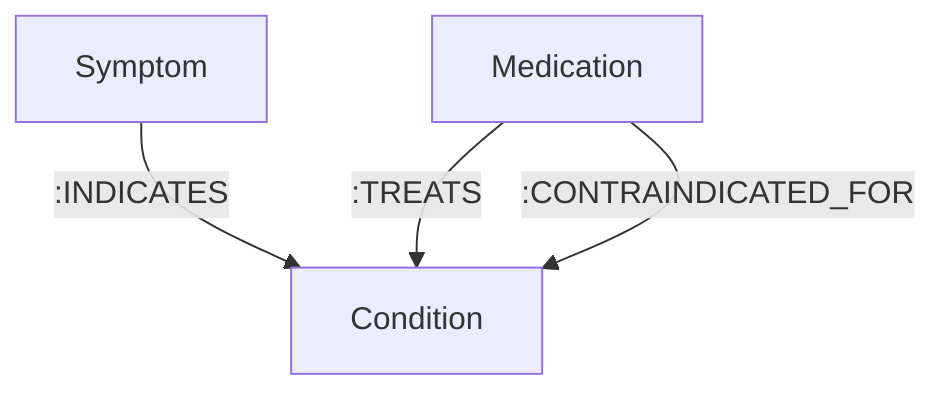

# 🧬 FalkorDB OpenCypher Queries & Graph Algorithms Reference

This document provides the exact OpenCypher queries, GraphBLAS linear algebra graph algorithms, and graph schemas used by **MediGraph**.

---

## 1. Graph Data Model (Schema Definition)



### Node Labels & Attributes
* `(:Symptom {name: STRING})`
* `(:Condition {name: STRING})`
* `(:Medication {name: STRING})`

### Relationship Types
* `[:INDICATES]` — Directed from `(Symptom)` to `(Condition)`.
* `[:TREATS]` — Directed from `(Medication)` to `(Condition)`.
* `[:CONTRAINDICATED_FOR]` — Directed from `(Medication)` to `(Condition)`.

---

## 2. Graph Algorithms Implemented

### Algorithm 1: Multi-Hop Shortest Path Traversal
* **Tool Name:** `find_shortest_clinical_path` (LangGraph) / `shortest_path_traversal` (MCP)
* **Underlying Engine:** FalkorDB GraphBLAS Matrix Breadth-First Traversal
* **Clinical Purpose:** Discovers multi-hop causal chains explaining *why* a proposed medication produces adverse events or is contraindicated in the context of the patient's existing disease network.
* **Cypher:**
```cypher
MATCH (a), (b)
WHERE toLower(a.name) CONTAINS toLower($source_entity) 
  AND toLower(b.name) CONTAINS toLower($target_entity) 
  AND a <> b
MATCH p = (a)-[*1..4]-(b)
RETURN [n IN nodes(p) | n.name] AS path_nodes, 
       [r IN relationships(p) | type(r)] AS rels, 
       length(p) AS hop_count
ORDER BY hop_count ASC
LIMIT 1;
```
* **Sample Execution Output:**
```json
{
  "source": "Ibuprofen",
  "target": "Atrial Fibrillation",
  "hop_count": 1,
  "causal_chain": "(Ibuprofen) -[CONTRAINDICATED_FOR]-> (Atrial Fibrillation)"
}
```

---

### Algorithm 2: Degree Centrality Hub Analysis
* **Tool Name:** `get_central_clinical_hubs` (LangGraph) / `symptom_centrality_ranking` (MCP)
* **Underlying Engine:** GraphBLAS Out-Degree & In-Degree Graph Vector Multiplication
* **Clinical Purpose:** When patients present with diffuse or non-specific symptoms, this algorithm identifies topological hubs connecting to severe acute pathologies, filtering peripheral noise.
* **Cypher:**
```cypher
MATCH (s:Symptom)-[:INDICATES]->(c:Condition)
WHERE toLower(s.name) IN [$symptom_list]
RETURN s.name AS symptom, 
       count(c) AS degree_centrality, 
       collect(c.name)[0..3] AS sample_conditions
ORDER BY degree_centrality DESC;
```
* **Sample Output:**
```json
{
  "centrality_rankings": [
    { "symptom": "Fatigue", "centrality_score": 16, "sample_conditions": ["Myocardial Infarction", "CHF", "Atrial Fibrillation"] },
    { "symptom": "Shortness of Breath", "centrality_score": 11, "sample_conditions": ["Hypertension", "Myocardial Infarction", "CHF"] },
    { "symptom": "Chest Pain", "centrality_score": 6, "sample_conditions": ["Hypertension", "Myocardial Infarction", "Angina"] }
  ]
}
```

---

### Algorithm 3: Comorbidity Community Detection
* **Tool Name:** `get_connected_clinical_community` (LangGraph) / `comorbidity_community_detection` (MCP)
* **Underlying Engine:** 2-Hop Bipartite Co-Occurrence Subgraph Projection
* **Clinical Purpose:** Discovers comorbidity disease communities sharing overlapping symptom neighborhoods with the diagnosed primary condition.
* **Cypher:**
```cypher
MATCH (c:Condition)<-[:INDICATES]-(s:Symptom)-[:INDICATES]->(related:Condition)
WHERE toLower(c.name) CONTAINS toLower($condition) AND related <> c
RETURN related.name AS comorbidity_cluster, 
       count(s) AS shared_symptoms_count, 
       collect(s.name)[0..4] AS sample_shared_symptoms
ORDER BY shared_symptoms_count DESC
LIMIT 4;
```
* **Sample Output (for Asthma):**
```json
{
  "primary_condition": "Asthma",
  "connected_communities": [
    { "condition": "COPD", "shared_manifestations_count": 3, "shared_symptoms": ["Shortness of Breath", "Wheezing", "Chest Tightness"] },
    { "condition": "Congestive Heart Failure", "shared_manifestations_count": 2, "shared_symptoms": ["Shortness of Breath", "Wheezing"] }
  ]
}
```

---

## 3. Core Operational Cypher Queries

### Query 1: Hybrid Sparse + Dense Symptom Matching
```cypher
MATCH (s:Symptom)-[:INDICATES]->(c:Condition)
WHERE toLower(s.name) CONTAINS toLower($query_symptom)
RETURN c.name AS condition;
```

### Query 2: Patient-Specific Contraindication Safety Check
```cypher
MATCH (m:Medication)-[:CONTRAINDICATED_FOR]->(c:Condition)
WHERE toLower(m.name) CONTAINS toLower($proposed_medication)
  AND toLower(c.name) CONTAINS toLower($patient_chronic_condition)
RETURN m.name AS medication, c.name AS condition;
```

### Query 3: Guideline-Directed Standard Treatment Retrieval
```cypher
MATCH (m:Medication)-[:TREATS]->(c:Condition)
WHERE toLower(c.name) CONTAINS toLower($confirmed_condition)
RETURN m.name AS medication;
```

### Query 4: Set-Difference Symptom Disambiguation
```cypher
MATCH (s:Symptom)-[:INDICATES]->(c:Condition)
WHERE c.name IN [$condition_a, $condition_b]
RETURN c.name AS condition, collect(s.name) AS symptoms;
```

---

## 4. Seeding & Indexing
To accelerate string lookups and sub-10ms graph traversals:
```cypher
CREATE INDEX FOR (c:Condition) ON (c.name);
CREATE INDEX FOR (s:Symptom) ON (s.name);
CREATE INDEX FOR (m:Medication) ON (m.name);
```
